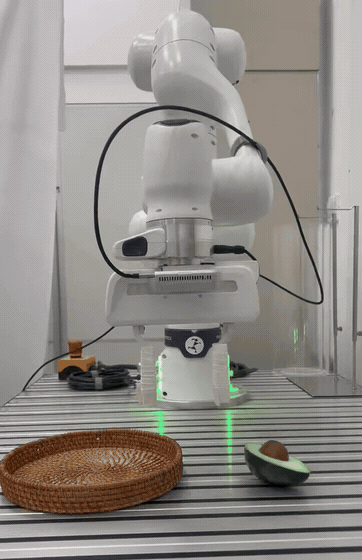
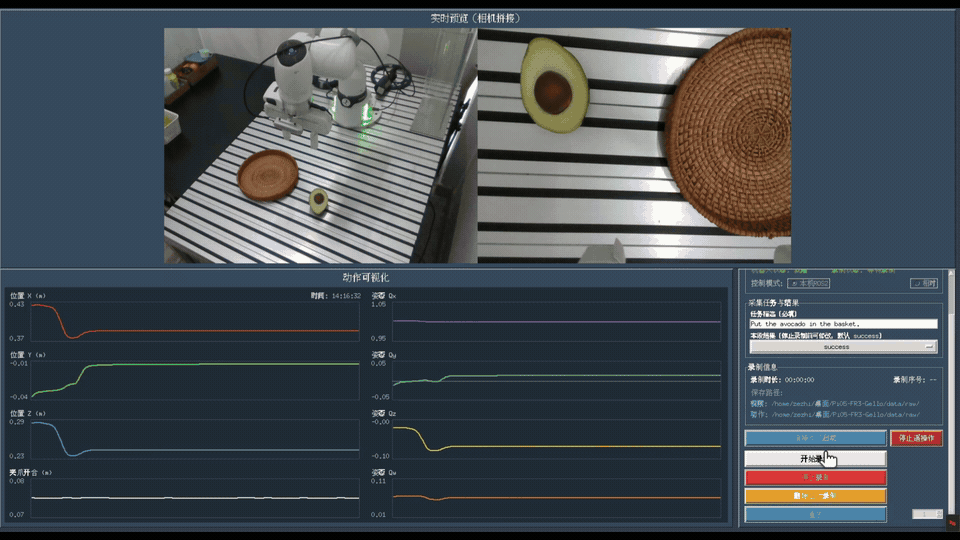
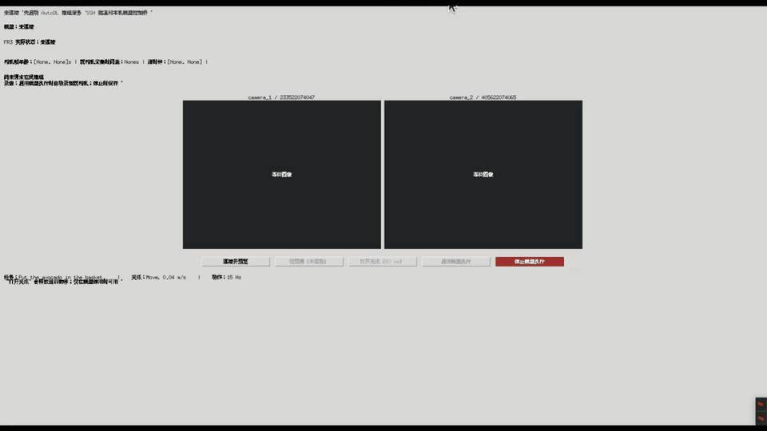
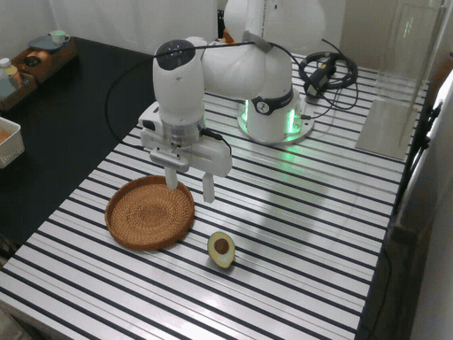
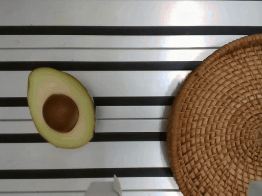

<h1 align="center">Pi05 × FR3 × GELLO</h1>

<h3 align="center">从 GELLO 遥操作示范到 π0.5 真机抓取部署</h3>

<p align="center">
  <a href="README.md">English</a> · 简体中文
</p>

<p align="center">
  🤗 <a href="https://huggingface.co/Metroooooooo/pi05-fr3-gello-avocado-12k">Model</a> /
  <a href="https://huggingface.co/datasets/Metroooooooo/fr3-gello-avocado-v30">Dataset</a> ·
  🎮 <a href="https://github.com/metro8116/Pi05-Mujoco">配套仿真项目</a>
</p>

<a id="overview"></a>

## 📌 项目简介

使用 **GELLO、Franka FR3 七轴机械臂、平行夹爪与两台 RealSense 相机**，完成从遥操作示范采集、数据转换、模型微调到真机部署的完整流程。以 [`lerobot/pi05_base`](https://huggingface.co/lerobot/pi05_base) 为基础模型，根据语言指令完成牛油果入篮任务：

> **Put the avocado in the basket.**



*项目演示（2 倍速）。*

机器人电脑负责双相机采集、交互界面与 ROS2 实时控制；云GPU服务器负责 π0.5 微调和推理。**两台机器使用同一个代码仓库，按角色运行不同入口。**

- **示范采集**：GELLO 遥操作、双相机预览、关节曲线、逐 episode 录制及任务结果标记。
- **数据处理**：原始记录校验、人工裁剪计划、LeRobot Dataset **v3.0** 导出与读回检查。
- **模型微调**：使用 **LeRobot 0.6.1 官方训练器**，保留官方采样、Accelerate、优化器与 checkpoint 保存恢复机制。
- **真机部署**：云GPU推理服务、SSH 通信、本机部署 GUI、独立开爪与执行停止。

<a id="contents"></a>

## 📚 目录

- [🛠️ 安装环境](#-安装环境)
- [🎮 遥操作收集数据](#-遥操作收集数据)
- [🎬 数据审查与格式转换](#-数据审查与格式转换)
- [🧠 训练与续训 π0.5](#-训练与续训-π05)
- [🤗 模型和数据集](#-模型和数据集)
- [🚀 部署 π0.5](#-部署-π05)
- [📈 验证范围](#-验证范围)
- [📖 详细文档](#-详细文档)
- [🙏 致谢与许可](#-致谢与许可)

<details>
<summary>📂 项目结构</summary>

```text
Pi05-FR3-Gello/
├── run.sh                          # 采集、转换、训练、部署的统一入口
├── capture/                        # 双相机采集 GUI、遥测桥与停止管理
├── tools/convert_to_lerobot_v30.py  # 原始记录校验与 v3.0 转换
├── train.py                        # 官方 LeRobot 训练入口适配
├── check_env.py                    # 数据、模型与 ML 环境检查
├── src/fr3_pi05/                   # FR3 数据接口、处理器与权重加载
├── deploy/                         # 云端推理服务、本机 GUI 与控制桥
├── common/                         # 采集与部署共用的控制权管理
├── ros2_ws/src/                    # GELLO、FR3 控制器与夹爪驱动
├── docker/                         # ROS Humble 镜像与固定版本源码准备
├── .devcontainer/                  # VS Code Dev Container 配置
├── requirements/                   # robot / converter / ml 依赖与 lock
├── configs/                        # 本机、云GPU环境配置模板
├── docs/                           # 从零配置、数据、训练和部署教程
├── media/                          # README 动图与训练损失曲线
├── tests/                          # 无硬件回归与合成数据测试
├── data/                           # 内置原始样例，以及单独准备的采集批次与 v3.0 数据集
└── outputs/、runs/、runtime/        # 训练输出、日志及会话状态
```

Git 已包含 `data/raw/avocado_batch01/record_001/` 一条原始示范和一段双相机部署录像，具体路径、内容与转换命令见 [内置样例说明](examples/README_zh.md)。完整数据集、模型权重、虚拟环境、私有配置及后续新生成的录像由默认忽略规则排除，单独准备。部署日志位于 `deploy/logs/`，推理过程录像位于 `deploy/recordings/`。

</details>

<a id="installation"></a>

## 🛠️ 安装环境

### 💻 环境与硬件分工

| 位置 | 环境 | 用途 |
| --- | --- | --- |
| 机器人电脑 | Ubuntu 20.04 / 22.04，具备 Franka 所需实时内核与网络配置 | 连接 FR3、GELLO 和两台 USB 3 RealSense |
| 机器人电脑 | `.venv-robot`，Python **3.10** | 采集 GUI、相机和部署客户端 |
| 机器人电脑 | ROS2 **Humble** Docker / VS Code Dev Container | GELLO、机械臂控制器、夹爪与 ROS 桥 |
| 数据处理电脑 | `.venv-converter`，Python **3.12** | LeRobot **0.6.1**、CPU PyTorch **2.11.0**、数据转换 |
| 云GPU服务器 | `.venv-ml`，Python **3.12** | LeRobot **0.6.1**、PyTorch **2.11.0+cu128**、训练和推理 |

三个 Python 环境通过 **uv** 分别创建，运行时由 `run.sh` 选择解释器，无需手动激活 Conda 环境。转换与训练使用相同版本的 LeRobot，分别安装 CPU 和 CUDA 依赖。**Dataset v3.0 是数据格式版本。**

首次配置先完成 [系统前提、实时内核、Docker、uv、USB 权限与 FR3 网络](docs/environments_zh.md)。ROS 容器共享主机内核，仍需要主机满足实时控制要求。

### 🤖 机器人电脑：采集与控制环境

将仓库放在本机，例如 `~/桌面/Pi05-FR3-Gello`，在项目根目录执行：

```bash
cd ~/桌面/Pi05-FR3-Gello
cp -n configs/local.env.example configs/local.env
# 编辑 configs/local.env，核对 FR3 IP、GELLO 串口与两台相机序列号。

./run.sh setup robot
./run.sh setup converter
./run.sh ros-image
./run.sh ros-up
./run.sh ros-build
./run.sh doctor
./run.sh collect --check
```

`ros-image` 构建独立镜像，源码按固定提交下载并进行 SHA256 校验，已完成的 Docker 层与源码缓存会复用。`ros-up` 启动空闲容器，`ros-build` 编译采集控制包；这三步不会启动机器人动作。

已有对应环境时跳过 `setup`；安装中断后可用 `./run.sh setup converter --resume` 继续该环境的安装，其他角色替换名称即可。该参数与模型断点续训不同。

默认 FR3 IP 为 `172.16.0.2`。GELLO 标定与相机配置来自当前设备，更换硬件时按 [配置教程](docs/environments_zh.md) 核对关节方向、偏移和相机顺序。VS Code 中使用 **Dev Containers: Reopen in Container** 开发 ROS；采集和部署 GUI 均在宿主机运行。

### ☁️ 云GPU：训练与推理环境

将同一版本仓库复制到云GPU服务器，例如 `/root/autodl-tmp/Pi05-FR3-Gello`：

```bash
cd /root/autodl-tmp/Pi05-FR3-Gello
cp -n configs/autodl.env.example configs/autodl.env

# 仅在需要新建 ML 环境时执行。
./run.sh setup ml
```

已有可用 uv 环境时，跳过 `setup ml`，在 `configs/autodl.env` 中设置解释器与资产路径：

```bash
export PI05_ML_PYTHON="/实际路径/已有环境/bin/python"
export PI05_BASE_MODEL="/实际路径/models--lerobot--pi05_base/snapshots/实际提交哈希"
export PI05_TOKENIZER="google/paligemma-3b-pt-224"
```

`run.sh` 自动读取配置。底座路径需包含 `config.json` 和单个完整 `model.safetensors`，应指向具体 snapshot，不能只填外层 Hub 缓存目录。Tokenizer 可以使用已有缓存 ID 或完整本地目录。

<details>
<summary>📦 首次下载底座与 tokenizer</summary>

使用新建的 ML 环境时，可在云GPU服务器的项目根目录执行：

```bash
.venv-ml/bin/hf auth login
.venv-ml/bin/hf download lerobot/pi05_base --local-dir ./models/pi05_base
.venv-ml/bin/hf download google/paligemma-3b-pt-224 \
  --include '*token*' '*vocab*' '*.model' 'config.json' 'special_tokens_map.json' \
  --local-dir ./models/paligemma-tokenizer
```

PaliGemma tokenizer 可能需要先在 Hugging Face 获得访问权限。下载完成后，在 `configs/autodl.env` 中设置：

```bash
export PI05_BASE_MODEL="$PI05_REPO_ROOT/models/pi05_base"
export PI05_TOKENIZER="$PI05_REPO_ROOT/models/paligemma-tokenizer"
```

训练和推理从本地资产离线加载。复用已有环境时使用该环境的 `hf` 命令，具体说明见 [模型资产准备](docs/environments_zh.md#6-autodl-新环境与模型资产)。

</details>

<a id="collection"></a>

## 🎮 遥操作收集数据



*遥操作示范采集过程（2 倍速）。*

在机器人电脑的项目根目录执行，以下流程统一使用批次目录 `avocado_batch01`：

```bash
./run.sh collect --output-dir ./data/raw/avocado_batch01
```

先确认 Franka Desk 已处于 **Execution + FCI**，现场可操作实体停止开关。采集界面打开后，按顺序操作：

| 操作 | 行为 |
| --- | --- |
| 确认预览与任务 | 检查两路相机、视角、关节曲线和语言指令 |
| 启动遥操作 | GELLO 开始控制 FR3，等待实际状态就绪 |
| 开始录制 | 创建一条新的 `record_NNN` |
| 完成抓取、放置与收手 | 保留完整开爪释放过程 |
| 停止录制 | 保存当前 episode，仍可继续遥操作 |
| 停止遥操作 | 结束机器人控制，再关闭采集窗口 |

默认指令为 **`Put the avocado in the basket.`**，每条记录的 outcome 默认 `success`；失败或中断的示范应在停止录制前改为 `failure` 或 `aborted`。成功标签由操作者根据实际任务结果确认。

**停止录制只停止保存数据，遥操作仍会继续。** 完整结束遥操也可在另一个本机终端执行：

```bash
./run.sh stop-collect
```

每条记录包含双路视频、原始图像、时间戳、JSON/HDF5 状态动作以及完整性元数据：

```text
data/raw/avocado_batch01/record_001/
├── metadata.json
├── action/
│   ├── action_data_*.json
│   └── action_data_*.h5
└── video/
    ├── camera_1_*.mp4
    ├── camera_2_*.mp4
    ├── camera_*_frames/frame_*.jpg
    └── frame_timestamps.json
```

相机以 **30 FPS** 获取 RGB，示范以 **15 FPS** 保存。夹爪采用 **Move，速度 0.04 m/s**，模型学习总开口宽度；Move 本身没有抓取力参数。

[遥操配置、录制与停止说明 →](docs/collection_zh.md)

<a id="dataset"></a>

## 🎬 数据审查与格式转换

结束录制并关闭采集程序后，先独立备份原始批次，再逐条查看两路 MP4，确认抓取、释放和收手完整。首尾静止帧可通过人工审核的 `--trim-plan` 裁剪，转换器会同步裁剪状态、动作和图像并重算统计；具体格式见 [裁剪计划](docs/data_zh.md#可选人工裁剪计划)。

### 1. 校验原始记录

```bash
./run.sh validate \
  --input-dir ./data/raw/avocado_batch01 \
  --output-dir ./data/lerobot/fr3_avocado_v30 \
  --report ./runs/avocado_batch01_validation.json
```

校验默认只选择 **完整且标为成功**的记录，检查状态动作、时间戳、相机顺序与视频帧数。报告应有非空 `selected` 和正数 `total_frames`；检查 `skipped` 与 `errors` 中的原因后再转换。

### 2. 导出 LeRobot Dataset v3.0

```bash
./run.sh convert \
  --input-dir ./data/raw/avocado_batch01 \
  --repo-id local/fr3_avocado_pi05 \
  --output-dir ./data/lerobot/fr3_avocado_v30
```

校验和转换均要求目标数据集目录尚不存在。转换会生成新目录，默认不划分验证集，全部有效 episode 用于训练。静止帧裁剪需显式提供审查后的计划；默认转换只做校验和筛选。

`--input-dir` 必须是直接包含 `record_*` 的目录。采集到 `data/raw/avocado_batch01` 后，转换时也要使用该批次路径。

```text
data/lerobot/fr3_avocado_v30/
├── data/chunk-000/file-*.parquet
├── meta/
│   ├── info.json
│   ├── stats.json
│   ├── tasks.parquet
│   ├── episodes/
│   └── conversion_manifest.json
└── videos/
    ├── observation.images.camera_1/
    └── observation.images.camera_2/
```

| 字段 | 维度 / 规格 | 含义 |
| --- | --- | --- |
| `observation.images.camera_1` | 640 × 480 RGB | 第一相机，默认序列号 `233522074047` |
| `observation.images.camera_2` | 640 × 480 RGB | 第二相机，默认序列号 `405622074065` |
| `observation.state` | 8 | 7 个实测关节角（rad）+ 实测夹爪总开口（m） |
| `action` | 8 | 7 个绝对关节目标（rad）+ 最近接受的夹爪目标总开口（m） |
| `task_index` | 1 | 对应任务表中的语言指令 |
| 记录 / 训练频率 | 15 FPS | 状态、动作与两路图像按帧对齐 |

夹爪开口范围为 **0–0.08 m**。夹住物体时，实际开口与目标开口可以不同；两者分别保存在 state 和 action 中。关节与开口以物理单位存储，训练时由保存的处理器根据数据统计量归一化。

将**整个** `fr3_avocado_v30/` 上传到云GPU服务器的 `data/lerobot/` 下，保留 `meta/`、`data/`、`videos/` 与转换来源记录。已有清洗完成的 v3.0 数据可以直接使用，无需再次转换或添加 `clean` 后缀。

[数据约定、备份、裁剪与上传说明 →](docs/data_zh.md)

<a id="training"></a>

## 🧠 训练与续训 π0.5

以下命令在**云GPU服务器**的项目根目录执行，先按安装部分配置本地底座与 tokenizer：

```bash
./run.sh check-train --dataset ./data/lerobot/fr3_avocado_v30
./run.sh train --dataset ./data/lerobot/fr3_avocado_v30 --dry-run
```

`check-train` 检查数据、视频样本、统计量、动作块、权重与 ML 环境；`--dry-run` 打印正式训练参数。首次配置可按 [训练教程](docs/training_zh.md) 先做两步训练与恢复检查。

需要 W&B 时，先在所选 ML 环境完成 `wandb login`。正式训练：

```bash
./run.sh train \
  --dataset ./data/lerobot/fr3_avocado_v30 \
  --offline \
  --gradient-checkpointing false \
  --batch-size 16 \
  --num-workers 8 \
  --steps 20000 \
  --save-freq 2000 \
  --log-freq 10 \
  --wandb true \
  --out ./outputs/fr3_avocado_pi05
```

底座由 `configs/autodl.env` 的 `PI05_BASE_MODEL` 指定，也可用 `--policy-path /完整底座目录` 覆写。`--data-root` 与 `--dataset`、`--output-dir` 与 `--out` 分别为同义参数。

| 设置 | 当前训练配置 |
| --- | --- |
| 训练器 | LeRobot 0.6.1 官方训练器 / Accelerate |
| 总更新步数 / batch size | 20,000 / 16 |
| workers / seed | 8 / 1000 |
| 保存间隔 / 日志间隔 | 2,000 / 10 步 |
| 计算精度 | CUDA + bfloat16 |
| 梯度检查点 | 关闭 |
| 视觉编码器 | 冻结，`train_expert_only=false` |
| action chunk | 50 步 |
| 优化器与调度 | AdamW，lr 2.5e-5，官方 π0.5 cosine preset |
| 数据划分 | 全部有效 episode，不划分验证集 |

示例显式启用了 W&B，命令默认值为关闭；无需日志服务时传 `--wandb false`。新训练使用尚不存在的输出目录。


*π0.5 训练损失曲线。*

### 断点续训

```bash
./run.sh resume \
  --resume-from ./outputs/fr3_avocado_pi05/checkpoints/last
```

恢复模型、处理器、优化器、scheduler、RNG 与官方步数，沿用原实验的训练计划。也可指定 `checkpoints/008000` 等数字断点；20k 计划从 8k 恢复时继续剩余 12k 步，保留原来的总步数即可。

```text
outputs/fr3_avocado_pi05/checkpoints/008000/
├── pretrained_model/     # 模型、配置、pre/postprocessor 与统计状态
└── training_state/       # 优化器、scheduler、RNG 与训练步数
```

**部署需要完整的 `pretrained_model/`；续训需要整个 checkpoint。** 首次加载 `pi05_base` 与恢复训练后的原生权重分别适配，训练循环、采样和保存恢复交由官方实现。

[完整训练参数、smoke 检查与断点迁移 →](docs/training_zh.md)

<a id="artifacts"></a>

## 🤗 模型和数据集

| 资源 | Hugging Face 链接 |
| --- | --- |
| LeRobot v3.0 真机数据集 | [Dataset](https://huggingface.co/datasets/Metroooooooo/fr3-gello-avocado-v30) |
| π0.5 微调 12k checkpoint | [Model](https://huggingface.co/Metroooooooo/pi05-fr3-gello-avocado-12k) |
| 原始遥操作数据集 | [Raw Dataset](https://huggingface.co/datasets/Metroooooooo/fr3-gello-avocado-raw) |

上表链接提供完整数据集和 12k 模型。Git 内置的两份样例用于查看记录格式与检查转换流程；部署录像与训练示范数据分开保存。

<a id="deployment"></a>

## 🚀 部署 π0.5

采用**云端推理、本机执行**：云GPU服务器加载微调模型，本机上传双相机图像和实际状态，接收绝对关节目标与夹爪宽度，再由本机 ROS2 执行。GELLO 用于采集示范，模型部署阶段使用相机和 FR3 控制链路。



*π0.5 部署过程（2 倍速）。*

### 1. 云GPU：启动推理服务

以 12k checkpoint 为例，先检查，再启动服务：

```bash
./run.sh serve \
  --checkpoint ./outputs/fr3_avocado_pi05/checkpoints/012000/pretrained_model \
  --check-only

./run.sh serve \
  --checkpoint ./outputs/fr3_avocado_pi05/checkpoints/012000/pretrained_model \
  --host 127.0.0.1 --port 8000
```

服务使用训练时保存的处理器和统计量，从 checkpoint 加载模型。选择其他步数时修改路径即可。训练与推理共用 GPU 时，先确认有足够空闲显存。

### 2. 机器人电脑：配置 SSH

```bash
cp -n configs/autodl.env.example configs/autodl.env
```

编辑**本机**的 `configs/autodl.env`，填写当前云GPU服务器的连接信息：

```bash
export PI05_SSH_HOST="你的云GPU主机名"
export PI05_SSH_PORT="你的SSH登录端口"
export PI05_SSH_USER="root"
export PI05_LOCAL_PORT="18000"
export PI05_REMOTE_PORT="8000"
```

先手动完成 SSH 主机密钥确认并配置密钥登录，再检查后台免交互登录：

```bash
source configs/autodl.env
ssh -o BatchMode=yes -o StrictHostKeyChecking=yes \
  -p "$PI05_SSH_PORT" "$PI05_SSH_USER@$PI05_SSH_HOST" true
```

SSH 登录端口使用云GPU平台提供的值，`18000` 和 `8000` 分别是本机转发端口与云端推理服务端口。部署程序默认管理 SSH 隧道。

### 3. 机器人电脑：准备与启动

结束遥操作采集或其他控制会话后执行：

```bash
./run.sh prepare
./run.sh deploy --network-check
./run.sh deploy --check
./run.sh deploy
```

`prepare` 编译并测试独立部署 overlay；`--network-check` 检查 SSH 与模型服务，`--check` 检查本机配置与依赖。部署配置位于 `deploy/configs/deploy.yaml`，更换 FR3 IP 时也需同步修改其中的 `robot.ip`，或按教程配置自己的副本。

部署窗口中依次操作：

| 按钮 | 行为 |
| --- | --- |
| 连接并预览 | 显示两路相机与实际状态，模型保持停用 |
| 仅预测（不运动） | 检查当前观测的预测结果 |
| 启用模型执行 | 确认现场条件后，启用本次模型控制并开始录像 |
| 停止模型执行 | 停止本次执行、保存录像，保留窗口与预览 |
| 打开夹爪（80 mm） | 在模型停用且停止完成后，单独打开夹爪 |

实际运动前，确认 Desk 的 Execution / FCI 状态、物体和机械臂起始位置，并在现场准备实体停止开关。采集与部署使用共享控制权锁，同一时刻只运行一个控制会话。

当前采用**串行分段推理**：每次预测 50 步，执行对齐后的最多 6 步前缀，再根据新观测推理；本机保留插值、限速、状态新鲜度和跟踪检查。RTC 尚未实现。

完整结束部署，在另一终端运行：

```bash
./run.sh stop-deploy
```

### 🎥 自动保存真机执行视频

每次启用模型执行，自动为两台相机创建一段录像；停止执行、保护停用或关窗时结束并保存。预览、仅预测和单独开爪不录制。

```text
deploy/recordings/<时间>_<执行会话>_<唯一标识>/
├── camera_1.mp4
├── camera_2.mp4
├── frames.jsonl
├── metadata.json
└── 编码日志
```

保存两路真实 RGB 视频、逐帧时间戳、帧数、丢帧与停止原因。可在 `configs/local.env` 中通过 `PI05_RECORDING_DIR` 设置保存位置。这些视频用于复盘推理过程，与遥操训练数据分别保存。

双相机执行录像示例（2 倍速）：

| 相机 1 | 相机 2 |
| --- | --- |
|  |  |

[SSH、GUI、夹爪交接、录像与故障排查 →](docs/deployment_zh.md)

<a id="verification"></a>

## 📈 验证范围

当前仓库已记录以下验证：

- robot / converter 新隔离环境安装与依赖一致性检查。
- 合成双相机数据导出 LeRobot v3.0、视频解码及训练 reader 读回。
- 采集会话、官方 checkpoint 适配、部署状态与双相机录像的 CPU 回归。
- 独立 ROS 镜像构建、libfranka、6 个 Franka ROS 包与 4 个项目自定义包编译，以及动态链接检查。

新镜像尚未完成现场硬件验收，GPU 完整训练、推理与实机表现需在对应环境中验证。具体通过项、跳过项与测试边界见 [验证记录](docs/verification_zh.md)。

```bash
./run.sh test
```

该入口运行无硬件回归；测试环境缺少可选依赖时会显示跳过。全部命令说明可用 `./run.sh help` 查看。

<a id="documentation"></a>

## 📖 详细文档

| 文档 | 内容 |
| --- | --- |
| [从零配置环境](docs/environments_zh.md) | Ubuntu、实时内核、FR3 网络、Docker / VS Code、uv、相机与模型资产 |
| [遥操与采集](docs/collection_zh.md) | GELLO 校准、GUI 操作、标签、遥操停止与原始记录 |
| [数据与转换](docs/data_zh.md) | 8 维接口、备份、审查裁剪、LeRobot v3.0 与来源追溯 |
| [训练与续训](docs/training_zh.md) | 官方训练器、20k / batch16、处理器、checkpoint 与恢复 |
| [两机部署](docs/deployment_zh.md) | 云GPU服务、SSH、预览、执行、开爪、录像和日志 |
| [依赖说明](requirements/README_zh.md) | 三个 Python 环境、版本锁与已有环境复用 |
| [镜像源码准备](docker/README_zh.md) | 固定提交、SHA256、源码缓存与断线重试 |
| [常见问题](docs/troubleshooting_zh.md) | FCI、相机、夹爪、数据、训练与部署问题 |

<a id="acknowledgements"></a>

## 🙏 致谢与许可

- [Hugging Face LeRobot](https://github.com/huggingface/lerobot)：π0.5 接入、数据集、处理器与官方训练基础设施。
- [GELLO](https://github.com/wuphilipp/gello_software)：遥操作硬件与软件。
- [Franka Robotics](https://github.com/frankarobotics)：libfranka 与 franka_ros2。
- [RealSense SDK](https://github.com/realsenseai/librealsense)：RGB 相机接口。
- [data-collection](https://github.com/renshaojie233/data-collection)：采集界面与同步录制的上游基础。
- [Pi05-Mujoco](https://github.com/metro8116/Pi05-Mujoco)：配套仿真工作流及本 README 的组织参考。

各组件保留原有版权、LICENSE 与 NOTICE，来源和适用条款见 [许可说明](LICENSE_zh.md)。
